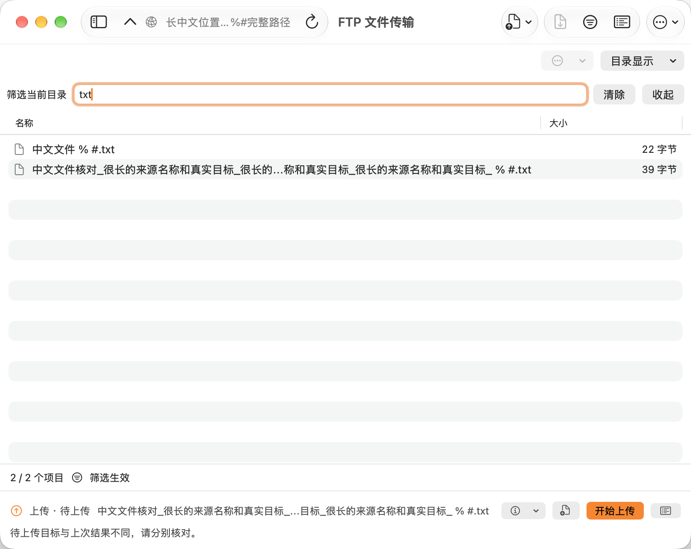

<p align="center">
  
</p>

<h1 align="center">FTP 文件传输</h1>

<p align="center"><strong>连接服务器，找到目录，安心传输。</strong></p>
<p align="center">轻量的原生 macOS 客户端，为日常文件与文件夹传输而设计。</p>

<p align="center">
  <a href="https://github.com/Lanjunyee/FTPUploader/releases/latest"></a>
  
  
</p>

<p align="center">
  <a href="https://github.com/Lanjunyee/FTPUploader/releases/latest"><strong>下载已发布版本</strong></a> ·
  <a href="#开始使用">快速上手</a> ·
  <a href="docs/workbench.md">工作台指南</a> ·
  <a href="https://github.com/Lanjunyee/FTPUploader/issues">反馈问题</a>
</p>

> **版本说明**：下面展示新版源码中的紧凑工作台。最新安装包 **v0.2.0 不包含此工作台、文件夹传输和 SFTP 私钥登录**；安装包能力与系统要求以 [Release 说明](https://github.com/Lanjunyee/FTPUploader/releases/latest) 为准。新版源码最低 macOS 15，目前未发布新安装包。

<p align="center">
  <picture>
    <source media="(prefers-color-scheme: dark)" srcset="docs/readme/workbench-dark.png">
    <source media="(prefers-color-scheme: light)" srcset="docs/readme/workbench-light.png">
    
  </picture>
  <br>
  <sub>真实本机测试服务器截图 · 跟随浅色／深色外观 · 支持系统强调色</sub>
</p>

## 简洁界面，完整流程

| 找到文件 | 核对后传输 | 看清每一步 |
| :--- | :--- | :--- |
| 站点收藏、目录排序、本地文件名筛选 | 单文件、文件夹与混合选择；先预览，再明确开始 | 双向摘要、完整队列、失败原因与最近记录 |

- **原生工作台**：可折叠站点栏，名称／大小为主的目录表格，完整位置与文件信息按需展开。浅深色自动适配，不用额外主题。
- **双向文件传输**：上传与下载保留文件夹名称、嵌套结构和空目录；覆盖需明确决策，失败项先生成新重试计划，不会自动重传。
- **按服务器选择协议**：FTP、显式／隐式 FTPS、SFTP；账户密码可选系统钥匙串，SFTP 可使用本地私钥，证书与主机指纹严格核验。

## 开始使用

1. **连接**：填写地址，例如 `ftp://example.com:21/uploads`，选择协议与登录方式，点击“连接”。选择站点或保存配置不会自动连接。
2. **定位**：双击文件夹进入目录；点击筛选图标，仅匹配当前已加载项目。它不是全站搜索，不刷新服务器，清除筛选不会恢复隐藏选择。
3. **传输**：从“上传”菜单选择文件，点击独立开始按钮；文件夹或混合选择先核对预览。下载通过所选项目菜单选择保存位置，文件夹或多选须确认计划后才开始。

选择、拖入、排序、查看详情或普通文件双击，都不会直接传输。

<details>
<summary><strong>常用快捷键</strong></summary>

| 操作 | 快捷键 |
| --- | --- |
| 选择单个上传文件 | `⌘O` |
| 上传文件／文件夹预览 | `⌘⇧B` |
| 开始单文件上传 | `⌘⇧U` |
| 下载所选项目 | `⌘D` |
| 筛选当前目录 | `⌘F` |
| 文件信息／完整名称 | `⌘I` |
| 打开唯一选中文件夹 | `⌘Return` |
| 队列与记录 | `⌘⇧H` |
| 取消当前操作 | `⌘.` |

快捷键与按钮使用相同安全守卫。覆盖提示中 Return 默认取消；取消请求发出后，资源释放前仍保持锁定。

</details>

## 使用前了解

- **FTP 不加密**。建议使用服务器支持的 FTPS 或 SFTP。FTPS 不提供跳过证书校验；SFTP 首次连接需独立核对指纹，密钥变化会阻止认证与传输。
- **不是整目录原子操作**。失败或取消保留已成功文件与已创建目录；不自动删除、回滚或重试。不支持续传、远程删除／改名／权限管理。
- **覆盖仍有并发边界**。下载目标变化需重新确认；检查与写入并非服务端条件原子操作，不能消除非合作客户端的所有竞态。
- **记录仅在本机**。最近 100 条记录包含文件名、服务器和路径，不含密码、私钥、口令或可恢复任务；重启不恢复队列。
- **发行验证未完成**。本地构建仍为 ad-hoc 签名，不代表 Developer ID／公证验证。实际 macOS 15 与 Intel 真机尚未实测；Rosetta 与通用编译不能替代。下载版本的签名与要求以 Release 为准。

## 开发与验证

当前源码最低 **macOS 15**。需要 Xcode、CMake、Perl、make 和 curl。FTP／FTPS 使用系统 libcurl，SFTP 静态链接固定版本的 libssh2 与 OpenSSL；[依赖来源和许可证](docs/secure-dependencies.md)随源码公开。

```sh
# 准备固定版本、双架构的静态依赖
./script/build_secure_dependencies.sh

# 编译应用（不会发布或创建安装包）
xcodebuild -project FTPUploader.xcodeproj -scheme FTPUploader \
  -configuration Debug -derivedDataPath .build/xcode build
```

自动测试需要本机 Python 3、TLS 测试证书，以及用于 SFTP 夹具的 Python 3.12 隔离环境：

```sh
python3 script/make_tls_fixtures.py .build/tls-fixtures
python3.12 -m venv .build/ssh-fixture-env
.build/ssh-fixture-env/bin/python -m pip install paramiko==4.0.0

xcodebuild -project FTPUploader.xcodeproj -scheme FTPUploader \
  -destination 'platform=macOS,arch=arm64' \
  -derivedDataPath .build/xcode test
```

测试服务只监听 loopback，使用一次性资源，不需要真实服务器凭据。验证范围与缺失环境见 [源码验证记录](docs/source-verification.md)。

## 文档与反馈

- [工作台指南](docs/workbench.md)：筛选、队列、覆盖、取消与历史。
- [SFTP 私钥登录](docs/sftp-private-key-auth.md)：支持格式、口令及文件关联。
- [安全协议迁移](docs/secure-connections-migration.md)：旧配置、钥匙串与降级边界。
- [报告问题](https://github.com/Lanjunyee/FTPUploader/issues)：请附系统版本、应用版本与脱敏错误；不要上传密码、私钥或真实服务器敏感资料。

---

<p align="center"><sub>原生界面，明确授权。让文件传输保持简单。</sub></p>
